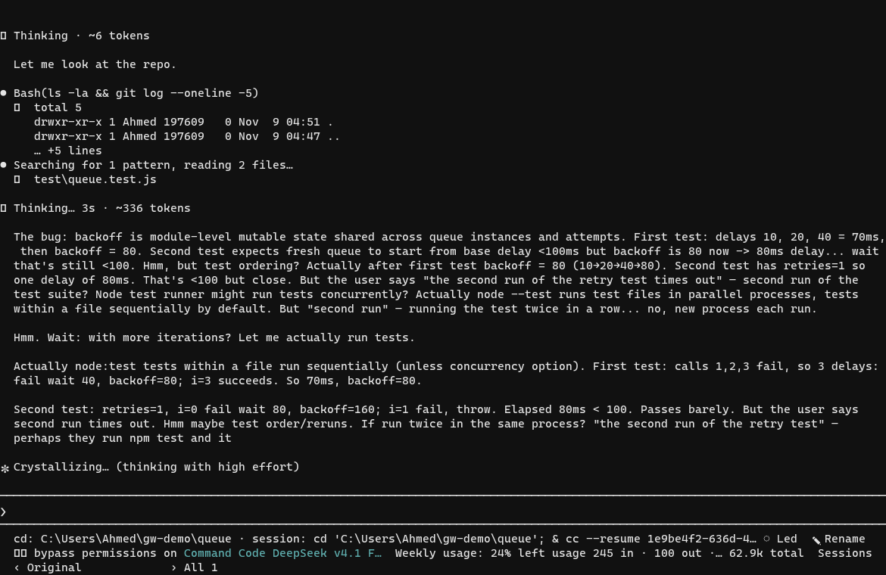
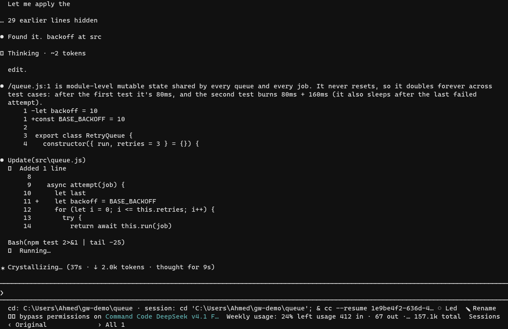
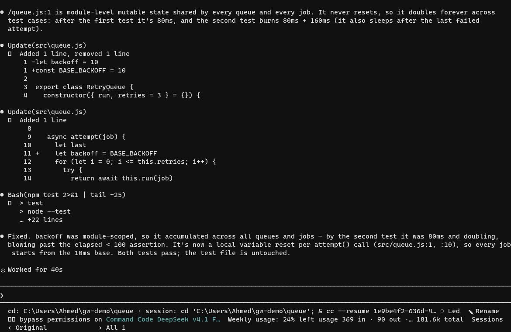

# Examples

A session, written out the way it actually goes, with the capture beside it. The
point is the shape of the workflow - where the agent reads, where it checks
itself, where a second session earns its keep - rather than a demo of a model
getting something right on the first try.

[`workflow.md`](workflow.md) has four of them. The first is captured end to
end: a small `RetryQueue` with a test that fails on the second run, and what the
session did about it.

| | |
|---|---|
|  |  |

The full loop, prompt to passing suite in a minute, is
[`media/01-session.gif`](media/01-session.gif) - four and a bit megabytes, so it
is the one heavy thing in here. The stills are the same session at the three
moments worth looking at: finding the cause, making the edit, proving it.

The other three examples in `workflow.md` - a family review, the rail, a second
provider - are the same workflow with a second session in the middle. Their
captures are not recorded yet; the text is the script they were staged from.

If you want to follow along in your own terminal, every step is a command or a
keystroke. The scratch repo the capture was taken from is small enough to
rebuild from the transcript.
