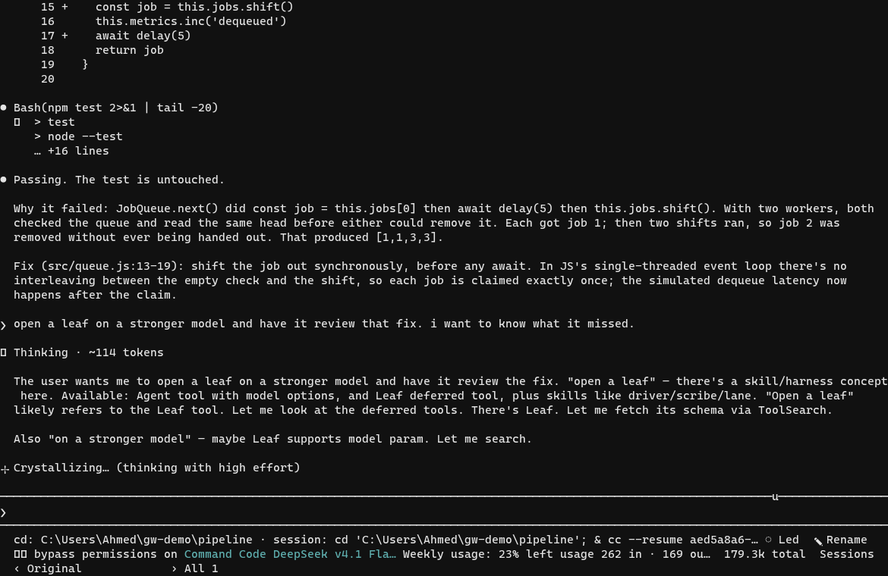
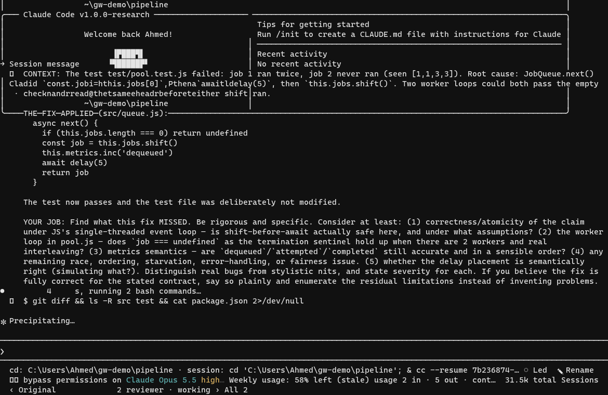
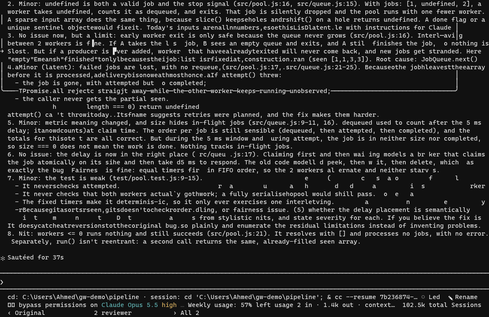

# The workflow

The first two examples are one recorded session on a scratch repo, and they are
the reason the family exists at all: one session does the work, a second one
reads it on a different model, and what it finds comes back on its own. The
rail and the mixed-provider notes below are written out but not recorded yet.

---

## 1. A failing test that isn't local

```
> the pool test fails: the same job runs twice and another never runs. find out why and fix it properly, dont touch the test.
```

The test says `saw [1,1,3,3]` when it wanted four different jobs. The session
reads four files, runs the suite, and finds it in `JobQueue.next()`: it takes
`jobs[0]`, awaits 5 ms, then shifts. Two workers start together, both read the
same head, both shift after the await, and one job is handed out twice while
another is shifted away and never runs.



It moves the shift in front of the await, so the claim is synchronous and the
check and the removal cannot interleave, runs the suite, and reports the test
file untouched. That part any decent agent does on a good day.

---

## 2. The second session

```
> open a leaf on a stronger model and have it review that fix. i want to know what it missed.
```

The leaf opens with the parent's context - the failure, the diff, the job it is
being given - so nothing has to be pasted or repeated. It runs on claude opus
5.5 while the parent stays on deepseek, which is the whole point: the reviewer
is not the same model agreeing with itself.



It is strict about it, because that is what it was asked for. It checks whether
shift-before-await really is atomic under the JS event loop, whether `undefined`
still works as the end sentinel with two workers, whether the `dequeued` metric
moved in a sensible order, and whether the test itself is strong enough to catch
the bug coming back. The answer arrives in the parent as a session message, in
the same conversation that made the fix:



That is the part a single session cannot do for itself. The parent believed its
own fix; the leaf ran on different weights and found the edges the parent had no
reason to look for. Nothing had to be re-explained, no context was lost, and the
disagreement is written down in both transcripts.

The whole loop, from the failing test to the leaf's findings, is
[`media/01-session.gif`](media/01-session.gif) - two minutes, three and a half
megabytes.

---

## 3. The question rail

When the agent needs a decision it can ask instead of guessing, and it does not
block the session on a modal while it waits.

```
> add retries to the fetch call

● Question: which failures should retry?
  a) connection errors only
  b) connection errors and 5xx
  c) everything except 4xx
```

Answer it with a key, or open **Chat** on it and add a note without answering:

```
> about the cap: we already have a deadline at the call site, so the backoff
  only needs to outlast a blip
```

The note goes to the model as context for that question. The question stays open
until it is actually answered, and answered ones can be cleared off the bar.

---

## 4. A mixed family

Any session in the family can sit on a different provider. `/openmodels` lists
what gateway can route to, `/limit` shows what the current provider says about
quota, and a leaf can run somewhere else while the parent stays where it is.

```
> /limit
  gateway-gpt-6-sol   quota ok, resets in 2h
> /leaf open a leaf on gateway-claude-sonnet-5-5 and ask it to review the plan
```

That is the cheapest way to find out if a model is worth its price on your work:
give it one review, not a whole project.
